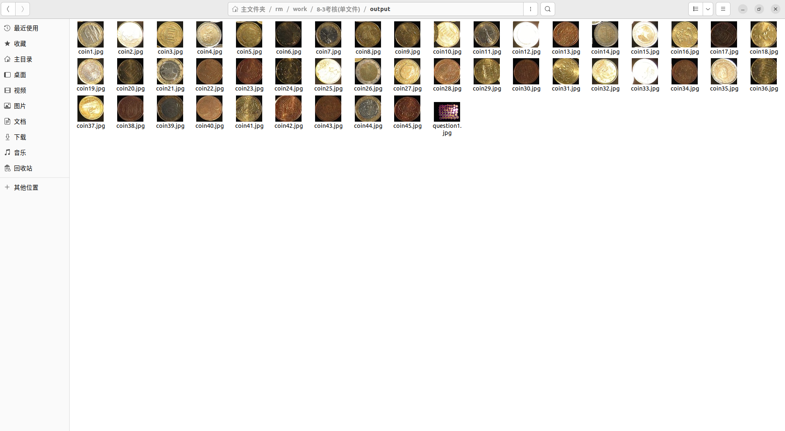
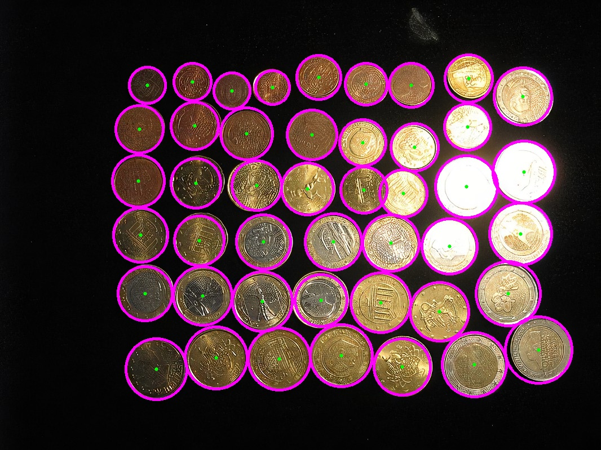
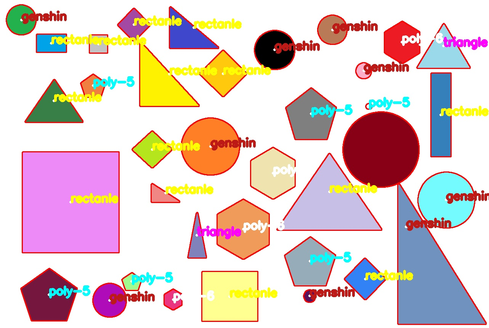

所有输入图像均放在 `input/` 文件夹下，输出图像均保存到 `output/` 文件夹下，输出图像命名应标明内容。每一个子题目对应一个源文件与一个可执行文件。

## 一、硬币提取

检测所有硬币的外轮廓，将每个硬币单独截取并逐个保存到 `output/` 目录下（如 `part1_coin_01.png`, `part1_coin_02.png` ...）。同时在原图中画出轮廓与圆心。

如图:





## 二、寻找图形外轮廓并计算面积

实现多边形/几何图形轮廓的面积测量，并通过交互式滑动条动态过滤指定面积范围的目标。在筛选出的图形旁边标注其面积数值。按 `q` 键退出程序，并将最终结果保存到 `output/part2_contour_area.png`。

如图:



## 建议目录结构

```bash
./
├── CMakeLists.txt
├── README.md
├── input/                          # 输入图像
│   ├── coins.png                   # Part 1 输入
│   └── shapes.png                  # Part 2 输入
├── output/                         # 输出图像
│   ├── part1_coin_01.png           # Part 1 单个硬币截取
│   ├── part1_coin_02.png
│   ├── part1_coins_result.png      # Part 1 提取结果
│   └── part2_contour_area.png      # Part 2 面积筛选结果
├── include/
├── src/
│   ├── part1_coin_extraction.cpp
│   └── part2_contour_area.cpp
└── build/
    ├── part1_coin_extraction
    └── part2_contour_area
```

