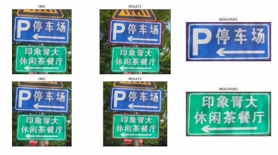
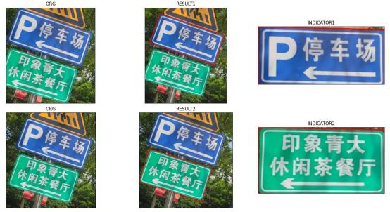
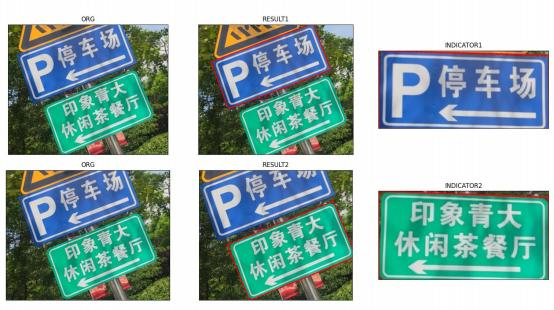

所有输入图像均放在 `images/` 文件夹下，蓝色、绿色指示牌分别保存到 `blue/`、`green/` 文件夹下，输出图像命名应标明内容。每一个子题目对应一个源文件与一个可执行文件。

## 一、蓝色与绿色指示牌提取

分别找出 `images/` 中 3 张图片里的蓝色指示牌和绿色指示牌，并将它们写入到 `blue/`、`green/` 两个文件夹中。

要求：
1. 用矩形框出指示牌。
2. 写入的指示牌需要尽量拉正。

运行结果如图：




## 建议目录结构

```bash
./
├── CMakeLists.txt
├── README.md
├── images/                         # 输入图像
│   ├── test1.png
│   ├── test2.png
│   └── test3.png
├── blue/                           # 蓝色指示牌输出
│   ├── part1_blue_1.png
│   ├── part1_blue_2.png
│   └── part1_blue_3.png
├── green/                          # 绿色指示牌输出
│   ├── part1_green_1.png
│   ├── part1_green_2.png
│   └── part1_green_3.png
├── include/
├── src/
│   └── part1_sign_detection.cpp
└── build/
    └── part1_sign_detection
```
