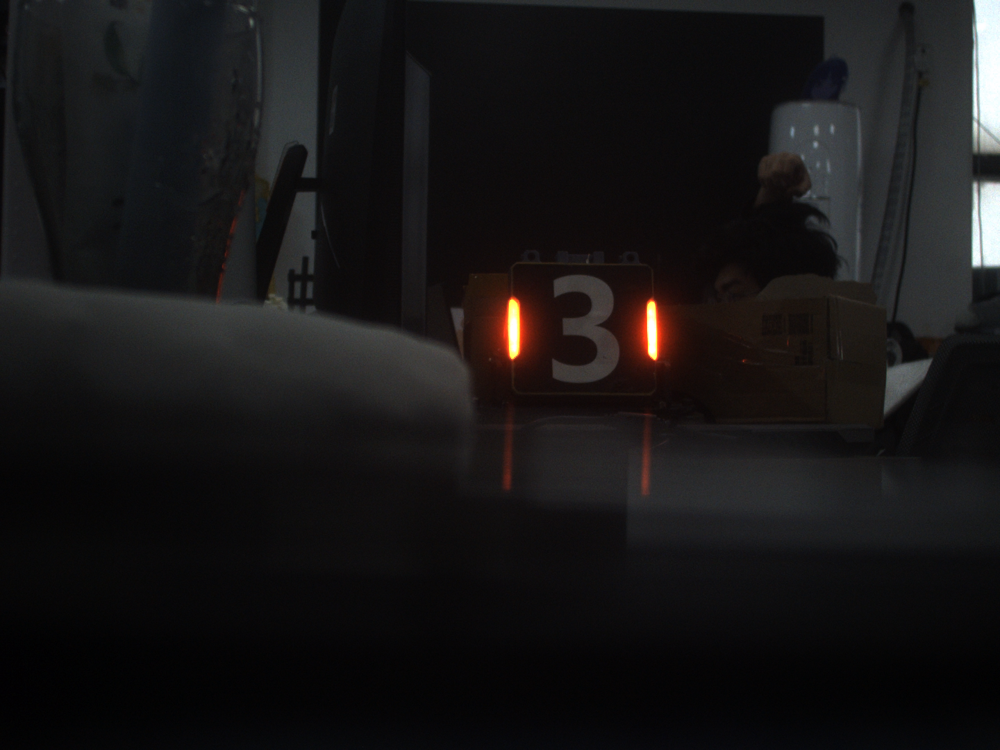
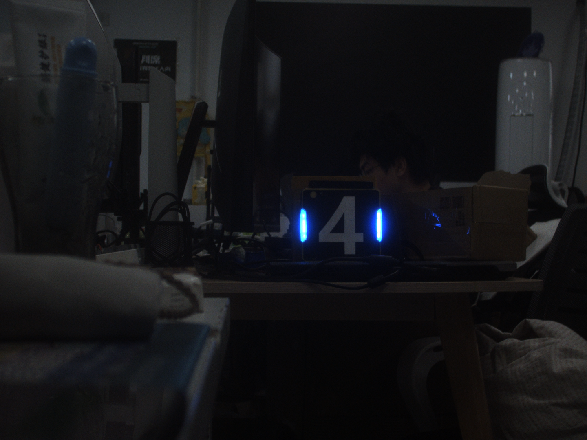

## 装甲板识别

测试用图片放在 `imgs/` 文件夹下，测试视频放在 `videos/` 文件夹下，中途测试图片可放在 `test/` 文件夹下，输出图像命名应标明内容。

本次任务要求在工业相机中识别真实的装甲板。因为这次作业需要装甲板，建议先拿 `imgs/` 里面的图片做测试，然后用 `videos/` 里面的视频做测试，最后有空可以来实验室借装甲板做实体测试（在实验室里面用，不能带走！带走了你学长就没有装甲板测自瞄啦！），我们会提供可用的工业相机驱动程序。

要求：
1. 用矩形框出装甲板或者框出两个灯条。
2. 灯条有红色与蓝色，要求可以通过仅修改启动参数切换识别的灯条颜色。
3. 装甲板与摄像头的距离与姿态不是固定不变的，要求识别率不会因距离远近与姿态变化降低太多。
4. 识别出灯条后再标出装甲板的中心，可以在图像上画个圆点来表示装甲板中心。

装甲板灯条示意如图：



## 建议目录结构

```bash
./
├── CMakeLists.txt
├── README.md
├── imgs/                           # 测试图片
│   ├── blue_straight_ahead.png		# 正对蓝色装甲板
│   ├── blue_tilted_left.png		# 左倾蓝色装甲板
│   ├── blue_tilted_right.png		# 右倾蓝色装甲板
│   ├── red_straight_ahead.png		# 正对红色装甲板
│   ├── red_tilted_left.png			# 左倾红色装甲板
│   └── red_tilted_right.png		# 右倾红色装甲板
├── videos/                         # 测试视频
│   └── armor.avi
├── test/                           # 中途测试图片（可选）
├── include/
├── src/
│   └── armor_detector.cpp
└── build/
    └── armor_detector
```


## 注意事项

1. 尽可能地**不借助** AI 完成本次作业。
2. 任务完成后**必须**前往实验室**线下测试并答辩**。
