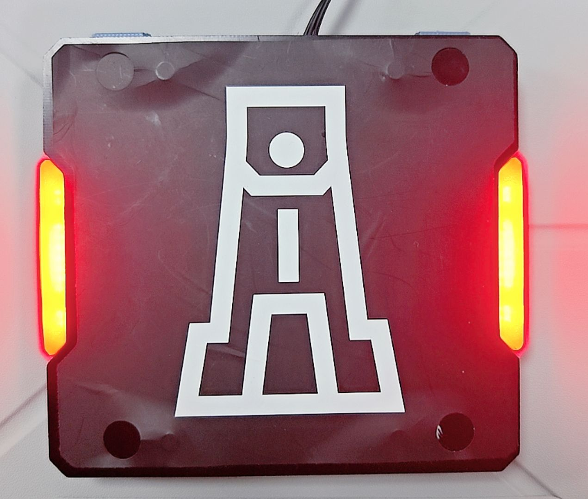
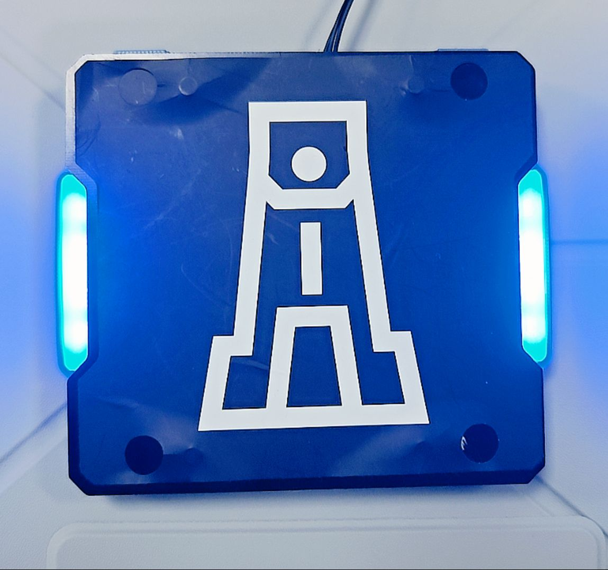
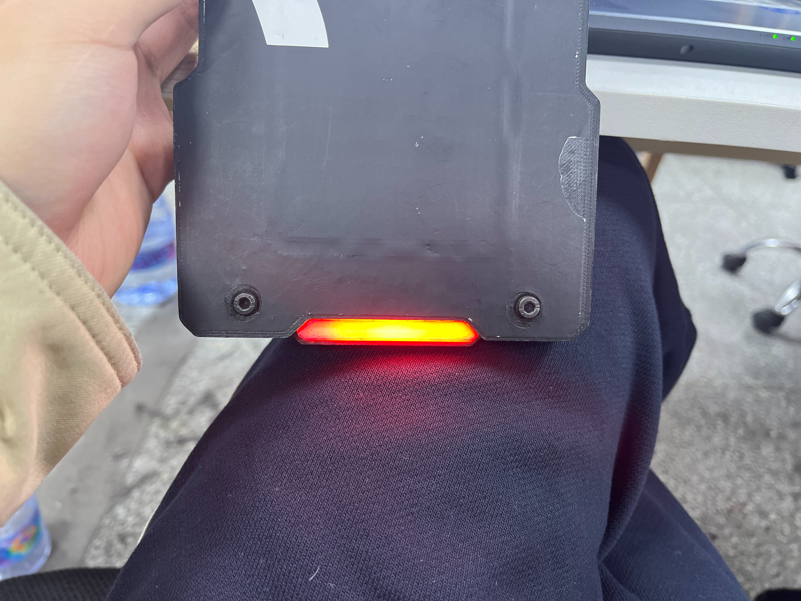

测试用图片放在 `imgs/` 文件夹下，测试视频放在 `videos/` 文件夹下，中途测试图片可放在 `test/` 文件夹下，输出图像命名应标明内容。每一个子题目对应一个源文件与一个可执行文件。

## 一、装甲板识别

在摄像头中，注意不是 `imgs/` 里面给你的图片，而是在摄像头里面识别一个真实的装甲板。因为这次作业需要装甲板，建议先拿 `imgs/` 里面的图片做测试，然后用 `videos/` 里面的视频做测试，最后有空可以来实验室借装甲板做实体测试（在实验室里面用，不能带走！带走了你学长就没有装甲板测自瞄啦！）

要求：
1. 用矩形框出装甲板或者框出两个灯条。
2. 灯条有红色与蓝色，要求可以通过仅修改启动参数切换识别的灯条颜色。
3. 装甲板与摄像头的距离不是固定不变的，要求识别率不会因距离远近降低太多。
4. 识别出灯条后再标出装甲板的中心，可以在图像上画个圆点来表示装甲板中心。

装甲板灯条示意如图：





## 建议目录结构

```bash
./
├── CMakeLists.txt
├── README.md
├── imgs/                           # 测试图片
│   ├── red.jpg                     # 红色灯条装甲板
│   ├── blue.jpg                    # 蓝色灯条装甲板
│   ├── single_red_bar.jpg          # 红色单灯条
│   ├── single_blue_bar.jpg         # 蓝色单灯条
│   ├── big_armor.jpg               # 大装甲板测试图
│   └── small_armor.jpg             # 小装甲板测试图
├── videos/                         # 测试视频
│   ├── red.mp4                     # 红色灯条视频
│   └── blue.mp4                    # 蓝色灯条视频
├── test/                           # 中途测试图片（可选）
│   ├── test1.png
│   ├── test2.png
│   └── test3.png
├── include/
├── src/
│   └── part1_armor_detector.cpp
└── build/
    └── part1_armor_detector
```
